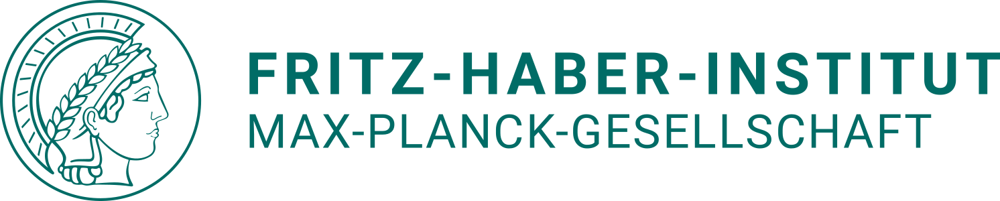
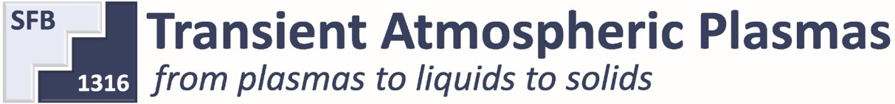

# Support

Most of the work has been supported by funding from the following institutions:

| | |
|---|---|
| [Institute of Electrochemistry, Ulm University (GER)](https://www.uni-ulm.de/en/nawi/institute-of-electrochemistry/) | [{width=200 .logo-bg}](https://www.uni-ulm.de/en/nawi/institute-of-electrochemistry/) |
| [Theory Department, Fritz-Haber Institute, Berlin (GER)](https://www.fhi.mpg.de/th-department) | [{width=200 .logo-bg}](https://www.fhi.mpg.de/th-department) |
| [Department of Materials Chemistry, National Institute of Chemistry, Ljubljana (SLO)](https://www.ki.si/en/departments/d10-department-of-materials-chemistry/) | [{width=200 .logo-bg}](https://www.ki.si/en/departments/d10-department-of-materials-chemistry/) |

The work is also supported by:

| | |
|---|---|
| [CRC-1316](https://sfb1316.ruhr-uni-bochum.de/) | [{width=250 .logo-bg}](https://sfb1316.ruhr-uni-bochum.de/) |
| [NFDI4Chem](https://nfdi4chem.de/) | [{width=200 .logo-bg}](https://nfdi4chem.de/) |

